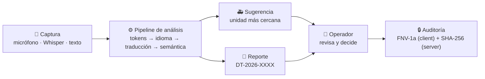

<div align="center">

# 🚨 Drive Tec

### Transcripción, traducción y gestión inteligente de llamadas de emergencia

*Escuchar una llamada en inglés… traducirla al español con confianza… extraer el incidente
y sugerir la unidad más cercana — **siempre con el operador al centro de la decisión**.*

[](LICENSE)
[](https://www.python.org/)
[](https://www.djangoproject.com/)
[](https://github.com/SYSTRAN/faster-whisper)
[](#-pruebas)
[](#-funcionalidades)
[-2E7DD1)](tijuana-districts.json)
[](core/app/index.html)

**Instituto Tecnológico de Tijuana** · Ingeniería en Sistemas Computacionales · Lenguajes y Autómatas II · 2026

</div>

> [!TIP]
> **Modo «elevador» (30 s):** pestaña *Llamada en vivo* → escenario *«Inglés · choque»* → traducción al español con % de confianza → tabla de símbolos detecta `choque vehicular · 2 heridos · prioridad alta` → el sistema sugiere la ambulancia **A-12** (la más cercana) → el operador aprueba y despacha → cada paso queda en una bitácora **verificable con hashes encadenados**.

---

## 🎬 El recorrido completo



Cada reporte avanza por un ciclo de vida explícito — y ninguna unidad se despacha con un clic accidental:

```mermaid
stateDiagram-v2
    [*] --> borrador : Generar reporte automático
    borrador --> aprobado : ✅ Aprobar
    aprobado --> despachado : 🚑 Despachar unidad `<dialog>` nativo
    despachado --> cerrado : 🔓 Cerrar y liberar
    cerrado --> [*]
    nota right of aprobado
        Los campos solo son editables en «borrador»:
        «El sistema recomienda; el operador decide»
    end note
```

---

## ✨ Funcionalidades

| Módulo | Qué hace |
|---|---|
| 🖥️ **Centro de mando** | KPIs (llamadas activas, unidades libres, respuesta promedio), mapa operativo y gráfica por tipo de incidente — canvas 2D nativo, sin CDN |
| 🎙️ **Llamada en vivo** | Micrófono (Web Speech), grabación → **Whisper local**, o texto; traducción EN/PT/FR→ES; tabla de símbolos semánticos y errores **señalados, nunca asumidos** |
| 📄 **Reporte** | Folio `DT-2026-NNNN`, edición controlada, flujo borrador → aprobado → despachado → cerrado, exportación a PDF |
| 🚑 **Unidades** | Mapa con **distritos reales de Tijuana**, geocodificación, ETA por unidad, asignación y animación de despacho |
| 🔒 **Auditoría** | Doble cadena de hashes (FNV-1a cliente + SHA-256 servidor), verificable con un clic |
| ✅ **Calidad y normas** | 10 pruebas automáticas, matriz RF/RNF y alineación ISO/IEEE/CMMI (dinámica; no es certificación) |

---

## 🧠 Cómo funciona (pipeline tipo compilador)

Del marco teórico de **Aho, Lam, Sethi y Ullman** aplicado a una llamada real de 911:

| Etapa | En la app | Concepto de la materia |
|---|---|---|
| Léxico | Tokenización y normalización | Analizador léxico (expresiones regulares) |
| Sintáctico | Detección de idioma por marcadores | Gramáticas y lenguajes regulares |
| Semántico | Traducción + extracción *tipo/heridos/ubicación/prioridad* | Análisis dirigido por sintaxis |
| Destino | Tabla de símbolos + errores semánticos | Tabla de símbolos y manejo de errores |
| Decisión | Sugerencia de unidad + **señalar faltantes sin asumirlos** | Generación de código dirigida |

```text
audio → tokens acústicos → estructura semántica → texto destino → decisión de recursos
```

---

## 🚀 Inicio rápido

<div align="center">

### `.\start.bat` y listo — modo simulado, **costo cero** y sin internet

</div>

<details open>
<summary><b>🪟 Windows (clase)</b></summary>

```powershell
git clone https://github.com/VictorMBojorquez/drivetec.git
cd drivetec
python -m pip install -r requirements.txt
.\crear-admin.bat      # una sola vez: crea el superusuario
.\start.bat            # abre el navegador y arranca
```

Capacidades en servidor (opcional):

```powershell
.\start.ps1 -WhisperModel base                                  # transcripción IA local (~75 MB al primer uso)
.\start.ps1 -WhisperModel base -GoogleServerKey "AIza…"         # + traducción/geocodificación Google
```
</details>

<details>
<summary><b>🐧 Linux / macOS</b></summary>

```bash
python -m pip install -r requirements.txt
DEBUG=1 python manage.py migrate && DEBUG=1 python manage.py createsuperuser
DEBUG=1 python manage.py runserver
```
</details>

<details>
<summary><b>🐳 Producción (VPS · Docker)</b></summary>

```bash
cp .env.example .env            # edita los valores
docker compose up -d --build
docker compose exec web python manage.py createsuperuser
```

Proxy HTTPS (Caddy/Nginx) hacia el puerto `8000` con `HTTPS=1`. Salud: `GET /healthz` o `/health`.
</details>

Abre `http://127.0.0.1:8000/` e inicia sesión.

---

## 🌐 API (sesión requerida · escrituras solo para staff/*Operador*)

<details>
<summary><b>Ver endpoints, límites de tasa y protecciones</b></summary>

| Ruta | Método | Función |
|---|---|---|
| `/api/state` | GET / PUT | Unidades, reportes y bitácora (persistencia en BD) |
| `/api/geocode` | POST | Dirección → coordenadas (Google Geocoding) |
| `/api/rank` | POST | ETA por unidad con tráfico (Google Routes; estimación si falla) |
| `/api/transcribe` | POST | Audio → texto con **faster-whisper local** (`WHISPER_MODEL`) |
| `/api/translate` | POST | Texto → español (Cloud Translation API; sin clave usa el glosario) |
| `/api/audit/verify` | GET | Verifica la doble cadena de hashes |
| `/healthz` · `/health` | GET | Comprobación de salud |

**Protecciones integradas:** sesión + CSRF · roles · límites de tasa por usuario (transcripción 10/min · traducción 30/min · geocodificación 20/min · ETA 60/min · estado 120/min) · validación estricta (`400`/`403`/`429`, **nunca `500`**).

</details>

<details>
<summary><b>Variables de entorno</b></summary>

| Variable | Uso |
|---|---|
| `SECRET_KEY` | Clave secreta de Django (**obligatoria** sin `DEBUG`) |
| `DB_PASSWORD` / `DATABASE_URL` | PostgreSQL en despliegue (SQLite por defecto en dev) |
| `ALLOWED_HOSTS` · `CSRF_TRUSTED_ORIGINS` | Dominios permitidos |
| `HTTPS` | `1` → cookies seguras, redirección SSL y HSTS |
| `DEBUG` | `1` solo en desarrollo |
| `GOOGLE_MAPS_KEY` | Clave de navegador (vacía = mapa simulado) |
| `GOOGLE_SERVER_KEY` | Clave de servidor para Geocoding, Routes y Translation |
| `WHISPER_MODEL` | `tiny`, `base`, `small`… (vacío = solo micrófono del navegador) |
| `WHISPER_DEVICE` · `WHISPER_COMPUTE` | `cpu`/`cuda` · `int8`/`float16` |

</details>

---

## 🏗️ Estructura del repositorio

```text
dt/
├── drivetec/                 # settings, urls, wsgi
├── core/
│   ├── models.py             # Unit · Report · AuditEvent
│   ├── views.py              # estado, geocodificación, ETA, Whisper, traducción, auditoría
│   ├── tests.py              # 23 pruebas de backend
│   ├── app/index.html        # 🎨 frontend completo (CSS, JS, HTML5 semántico)
│   └── static/               # maps.js · simmap.js (mapa canvas + distritos reales)
├── tijuana-districts.json    # 🗺️ distritos de Tijuana (GeoJSON) — referencia del mapa
├── tools/mkdist.js           # regenera la capa de distritos (node tools/mkdist.js --write)
├── start.bat · start.ps1 · crear-admin.bat
├── Dockerfile · docker-compose.yml   # despliegue con healthchecks
├── DriveTec_Documentacion.md # 📚 documento académico completo del proyecto
└── LICENSE                   # MIT
```

---

## ✅ Pruebas

```bash
python manage.py test      # 23 pruebas de backend: auth, roles, validación, auditoría, ranking
```

En la app, pestaña **Calidad y normas**: 10 casos `PR-01…PR-10` (multilingüe, datos faltantes,
unidad ocupada, latencia < 50 ms, detección de alteración en la cadena…).

---

## 🔐 Seguridad y privacidad

- Acceso con sesión y CSRF; la API responde `401` sin autenticación y `403` sin rol.
- La clave de Maps *de navegador* se restringe por HTTP referrer; la *de servidor* nunca llega al cliente.
- **Whisper local**: el audio se transcribe en tu servidor y no sale de él.
- Con Google activo, direcciones y texto viajan a sus APIs (la UI lo avisa).
- Minimización de datos, folios únicos e integridad verificable por doble cadena de hashes.

---

## 🧭 Hoja de ruta

- [x] Pipeline multilingüe EN/PT/FR → ES con confianza medida
- [x] Mapa simulado con **distritos reales de Tijuana** (GeoJSON propio)
- [x] Doble auditoría verificable cliente + servidor
- [x] Frontend de un solo archivo con HTML5 semántico (`<dialog>`, `<details>`, `<mark>`, `<time>`)
- [ ] GPS en vivo y seguimiento de unidades en tiempo real
- [ ] Roles granulares (supervisor / operador)
- [ ] Cifrado en reposo y respaldos programados
- [ ] Pruebas de carga y observabilidad

---

<div align="center">

### 👥 Equipo

**Ballesteros Cruz Aldo Juvetino** · **Bojorquez Valdez Victor Manuel** · **Grande Ortega Maximiliano Alberto**

Instituto Tecnológico de Tijuana · Ingeniería en Sistemas Computacionales · Lenguajes y Autómatas II

📚 Documentación formal del proyecto: [`DriveTec_Documentacion.md`](DriveTec_Documentacion.md) · 📄 Licencia: [MIT](LICENSE)

> *Escuchar mejor para responder más rápido.*

</div>
