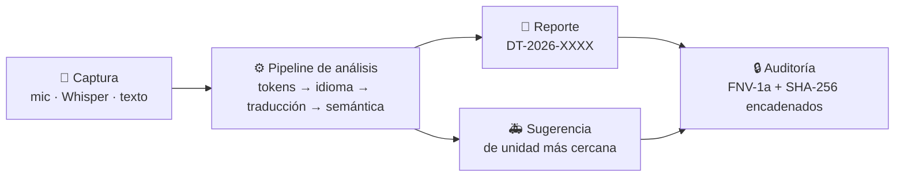

# 🚨 Drive Tec

**Transcripción, traducción y gestión inteligente de llamadas de emergencia.**

Una llamada multilingüe entra por micrófono (o texto), el sistema la transcribe, detecta el idioma,
la traduce al español, extrae los datos críticos del incidente (tipo, ubicación, heridos, prioridad),
genera un reporte auditable y sugiere la unidad de respuesta más cercana — con el **operador al centro
de la decisión final**.

[](LICENSE)
[](https://www.python.org/)
[](https://www.djangoproject.com/)
[](https://github.com/SYSTRAN/faster-whisper)
[](#-pruebas)
[](AGENTS.md)

> 🎓 Proyecto académico · Instituto Tecnológico de Tijuana · Lenguajes y Autómatas II

---

## 👀 En 30 segundos



**Modo «elevador»:** *escucha una llamada en inglés → ve la traducción al español con su nivel de
confianza → la tabla de símbolos detecta “choque vehicular, 2 heridos, prioridad alta” → el sistema
sugiere la ambulancia A-12 (la más cercana) → el operador aprueba y despacha → cada paso queda en una
bitácora verificable con hashes encadenados.*

---

## 🎬 Guion de demostración (2 minutos)

| # | Paso | Qué esperar |
|---|------|-------------|
| 1 | Pestaña **Llamada en vivo** → botón de escenario **«Inglés · choque»** | Traducción al español, idioma `EN`, confianza %, motor usado |
| 2 | Observa el panel derecho | Tabla de símbolos (`tipo_incidente`, `num_personas`, `nivel_triage`…) y **errores señalados, nunca asumidos** |
| 3 | **Generar reporte automático** | Folio `DT-2026-NNNN`, estado «borrador», entra en el flujo completo con sugerencia de unidad |
| 4 | **Aprobar → Despachar unidad → Cerrar y liberar** | La unidad cambia a ocupada/libre en el mapa; se mide el tiempo de respuesta |
| 5 | Pestaña **Unidades** → «Ubicar y calcular ETA» | Ranking por tiempo de llegada (Google Routes o estimación) |
| 6 | Pestaña **Auditoría** → «Verificar integridad» + «Verificar en servidor» | ✔ Cadena íntegra en cliente (FNV-1a) y servidor (SHA-256) |
| 7 | Pestaña **Calidad y normas** → «Ejecutar pruebas» | 10 casos automáticos en verde, matriz de requisitos y normas |

**Rutas alternas para impresionar:**
- 🎙 **Escuchar (navegador)** — dictado real-time (Chrome/Edge).
- 🎧 **Transcribir (servidor)** — graba y manda el audio a **Whisper local**; funciona en cualquier navegador, offline.
- 🌐 **Servidor (Google)** — traducción con Cloud Translation API para texto libre fuera del glosario (opcional).
- Modo **sin internet ni claves**: glosarios deterministas + mapa canvas simulado. Cero costo, cero llamadas externas.

---

## ✨ Funcionalidades

| Módulo | Qué hace |
|---|---|
| 🖥️ Centro de mando | KPIs de llamadas activas, unidades libres, respuesta promedio, mapa operativo y gráfica por tipo de incidente |
| 🎙️ Llamada en vivo | Micrófono (Web Speech), grabación → **Whisper local**, o texto; traducción EN/PT/FR→ES; tabla de símbolos y errores |
| 📄 Reporte | Folio `DT-2026-NNNN`, edición de campos, flujo borrador → aprobado → despachado → cerrado, exportación a PDF |
| 🚑 Unidades | Mapa, geocodificación de dirección, ETA por unidad, asignación, liberación y animación de despacho |
| 🔒 Auditoría | Bitácora con doble cadena de hashes (FNV-1a cliente + SHA-256 servidor), verificable con un clic |
| ✅ Calidad y normas | 10 pruebas automáticas, matriz de requisitos RF/RNF y alineación ISO/IEEE/CMMI (dinámica, no certificación) |

**Modelado como compilador:** pipeline de 5 etapas
`audio → tokens acústicos → estructura semántica → texto destino → decisión` — del marco teórico de
Aho, Lam, Sethi y Ullman aplicado a una llamada real.

---

## 🚀 Inicio rápido

### Windows (recomendado para clase)
```powershell
git clone https://github.com/VictorMBojorquez/drivetec.git
cd drivetec
python -m pip install -r requirements.txt
.\crear-admin.bat      # una sola vez: crea el superusuario
.\start.bat            # abre el navegador y arranca (modo simulado, costo cero)
```

Con capacidades en servidor, desde PowerShell:
```powershell
.\start.ps1 -WhisperModel base                    # transcripción IA local (descarga ~75 MB en el 1.er uso)
.\start.ps1 -WhisperModel base -GoogleServerKey "AIza…"   # + traducción/geocodificación Google
```

### Linux / macOS
```bash
python -m pip install -r requirements.txt
DEBUG=1 python manage.py migrate && DEBUG=1 python manage.py createsuperuser
DEBUG=1 python manage.py runserver
```
Abre `http://127.0.0.1:8000/` e inicia sesión.

### Producción (VPS · Docker)
```bash
cp .env.example .env            # edita los valores
docker compose up -d --build
docker compose exec web python manage.py createsuperuser
```
Pon un proxy HTTPS (Caddy/Nginx) hacia el puerto 8000 y `HTTPS=1`. Salud: `GET /healthz` o `/health`.

---

## 🧠 ¿Cómo funciona?

1. **Léxico** — el texto se normaliza y tokeniza.
2. **Detección de idioma** — marcadores de EN/PT/FR/ES; el glosario traduce con conteo de confianza.
3. **Traducción** — glosarios deterministas (auditable) o **Cloud Translation API** si hay clave.
4. **Semántica** — extrae tipo de incidente, heridos, ubicación (gazetteer), condición y prioridad.
5. **Decisión** — sugiere la unidad más cercana del tipo correcto; **señala datos faltantes en vez de asumirlos**.

### Arquitectura

```
dt/
├── drivetec/            # settings, urls, wsgi
├── core/
│   ├── models.py        # Unit · Report · AuditEvent
│   ├── views.py         # estado, geocodificación, ETA, Whisper, traducción, auditoría
│   ├── admin.py         # /admin/ con bitácora de solo lectura
│   ├── tests.py         # 23 pruebas de backend
│   ├── app/index.html   # frontend completo (dashboard + pipeline)
│   └── static/          # maps.js · simmap.js (mapa canvas simulado)
├── start.bat / start.ps1 / crear-admin.bat
├── CLAUDE.md · AGENTS.md       # manual para agentes de IA (Claude Code, OpenCode, Codex…)
├── CLAUDE_EXPORT.md            # mismo contexto, autocontenido, para subir a Claude.ai
├── Dockerfile · docker-compose.yml (con healthchecks)
└── DriveTec_Documentacion.md   # documento completo del proyecto
```

---

## 🌐 API (requiere sesión · grupo «Operador» para escrituras)

| Ruta | Método | Función |
|---|---|---|
| `/api/state` | GET / PUT | Unidades, reportes, bitácora (persistencia en BD) |
| `/api/geocode` | POST | Dirección → coordenadas (Google Geocoding) |
| `/api/rank` | POST | ETA por unidad con tráfico (Google Routes; estimación si falla) |
| `/api/transcribe` | POST | Audio → texto con **faster-whisper local** (se activa con `WHISPER_MODEL`) |
| `/api/translate` | POST | Texto → español (Cloud Translation API; sin clave usa el glosario) |
| `/api/audit/verify` | GET | Verifica la doble cadena de hashes |
| `/healthz` · `/health` | GET | Comprobación de salud |

Protecciones integradas: sesión + CSRF · roles (staff/grupo *Operador*) · límites de tasa por usuario
(transcripción 10/min · traducción 30/min · geocodificación 20/min · ETA 60/min · estado 120/min) ·
validación estricta de entradas (`400`/`403`/`429`, nunca `500`).

---

## ✅ Pruebas

```bash
python manage.py test      # 23 pruebas de backend: auth, roles, validación, auditoría, ranking
```

En la app, pestaña **Calidad y normas**: 10 casos PR-01…PR-10 (multilingüe, datos faltantes,
unidad ocupada, latencia < 50 ms, cadena de auditoría…).

---

## 🤖 Agentes de IA (Claude Code y compatibles)

Este repositorio está preparado para que un agente de IA trabaje en él **sin contexto previo**:

| Archivo | Quién lo lee | Qué contiene |
|---|---|---|
| [`AGENTS.md`](AGENTS.md) | OpenCode, Codex, Cursor y cualquier agente compatible | Manual canónico: reglas de oro, comandos, mapa del código, flujo de verificación y pendientes |
| [`CLAUDE.md`](CLAUDE.md) | Claude Code (automático al abrir la carpeta) | Importa `AGENTS.md` (`@AGENTS.md`), así la fuente única se mantiene en un solo archivo |
| [`CLAUDE_EXPORT.md`](CLAUDE_EXPORT.md) | Claude.ai (Proyecto → Conocimiento) o cualquier chat sin acceso al repo | **Contexto exportable autocontenido**: arquitectura, comandos, reglas, anatomía del código y glosario en un solo documento |

Para trabajar con el sistema usando IA: abre la carpeta del proyecto y ejecuta `claude`
(Claude Code) u `opencode`; el agente cargará la guía automáticamente.

Reglas no negociables que el agente respetará (y que conviene que cualquier colaborador también):

1. **Las 23 pruebas de backend deben quedar en verde** tras cada cambio (`python manage.py test`).
2. El frontend vive en **un solo archivo** (`core/app/index.html`) con estilo compacto — no reformatear.
3. **Todo en español**: código, comentarios, commits, UI y mensajes.
4. Cero dependencias externas de runtime: la app debe funcionar sin internet ni claves (modo simulado).
5. Verificación mínima antes de commit: `manage.py test` + `manage.py check` + `node --check` del JS.

---

## 🔐 Seguridad y privacidad

- Acceso con sesión y CSRF; la API responde `401` sin autenticación y `403` sin rol.
- La clave de Maps *de navegador* se restringe por HTTP referrer; la *de servidor* nunca llega al cliente.
- **Whisper local:** el audio se transcribe en tu servidor y no sale de él.
- Con Google activo, direcciones y texto viajan a sus APIs (aviso operado en la UI).
- Minimización de datos, folios únicos e integridad verificable por doble cadena de hashes.

---

## 📑 Variables de entorno

| Variable | Uso |
|---|---|
| `SECRET_KEY` | Clave secreta de Django (**obligatoria** sin `DEBUG`) |
| `DB_PASSWORD` / `DATABASE_URL` | PostgreSQL en despliegue (SQLite por defecto en dev) |
| `ALLOWED_HOSTS` · `CSRF_TRUSTED_ORIGINS` | Dominios permitidos |
| `HTTPS` | `1` → cookies seguras, redirección SSL y HSTS |
| `DEBUG` | `1` solo en desarrollo |
| `GOOGLE_MAPS_KEY` | Clave de navegador (vacía = mapa simulado) |
| `GOOGLE_SERVER_KEY` | Clave de servidor para Geocoding, Routes y Translation |
| `WHISPER_MODEL` | `tiny`, `base`, `small`… (vacío = solo micrófono del navegador) |
| `WHISPER_DEVICE` · `WHISPER_COMPUTE` | `cpu`/`cuda` · `int8`/`float16` |

---

## 🧭 Limitaciones y siguientes pasos

- Coordenadas y unidades de demostración (edita `SEED` en `core/migrations/0002_seed_and_rehash.py`).
- Sin GPS en vivo, sin roles granulares (supervisor), sin cifrado en reposo ni pruebas de carga.
- La traducción por glosarios es determinista; para texto libre usa el motor de Google o conecta un MT propio.
- Hoja de ruta: transcripción GPS en streaming → roles supervisor/operador → respaldos y cifrado en reposo → pruebas de carga.

## 👥 Créditos

- **Ballesteros Cruz Aldo Juvetino**
- **Bojorquez Valdez Victor Manuel**
- **Grande Ortega Maximiliano Alberto**

Instituto Tecnológico de Tijuana · Ingeniería en Sistemas Computacionales · Lenguajes y Autómatas II · 2026

> *Escuchar mejor para responder más rápido.*

## 📄 Licencia

[MIT](LICENSE) — uso libre mencionando al equipo del proyecto.
