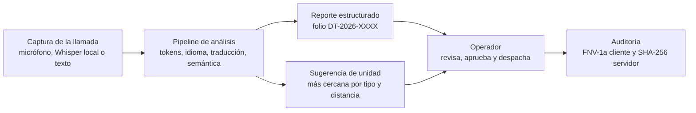
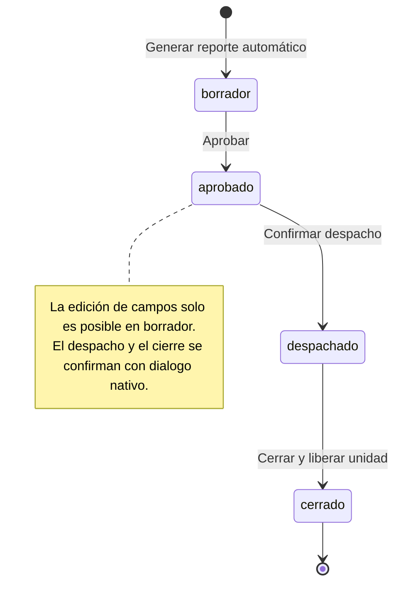

<div align="center">

# Drive Tec

### Sistema de transcripción, traducción y gestión inteligente de llamadas de emergencia

Drive Tec recibe una llamada de emergencia multilingüe, la transcribe, detecta el idioma, la traduce
al español, extrae los datos críticos del incidente y **sugiere** la unidad de respuesta más cercana.
La decisión final corresponde siempre al operador.

[](LICENSE)
[](https://www.python.org/)
[](https://www.djangoproject.com/)
[](https://github.com/SYSTRAN/faster-whisper)
[](#verificación-y-pruebas)
[](#funcionalidades)
[](tijuana-districts.json)
[](core/app/index.html)

**Instituto Tecnológico de Tijuana** · Ingeniería en Sistemas Computacionales · Lenguajes y Autómatas II · 2026

</div>

> [!NOTE]
> Diseño de operación: **el sistema recomienda; el operador decide**. Los datos no identificados
> se señalan de forma explícita en la interfaz y en la auditoría; el sistema nunca los asume ni
> ejecuta acciones sensibles sin confirmación.

---

## Resumen

Drive Tec es una aplicación web Django orientada a la operación de despachos de emergencia. Utiliza
el paralelo entre un compilador y una llamada real: el audio o texto se somete a una **canalización
de cinco etapas** (análisis léxico, detección de idioma, traducción, análisis semántico y decisión
de recursos) que produce un reporte estructurado y auditable. La transcripción de voz puede
realizarse de dos formas: en el navegador (Web Speech API) o en el servidor con *faster-whisper*
local, de modo que el audio no abandona el servidor. Cada paso queda registrado en una bitácora con
**cadenas de hashes encadenadas** (FNV-1a en el cliente y SHA-256 en el servidor) verificables.

El sistema funciona **sin dependencias externas de runtime**: sin claves ni conexión, el modo
simulado emplea glosarios deterministas y un mapa con los distritos reales de Tijuana (GeoJSON).

---

## Arquitectura del flujo de atención



## Ciclo de vida del reporte



---

## Funcionalidades

| Módulo | Descripción |
|---|---|
| **Centro de mando** | Indicadores de llamadas activas, unidades libres y tiempo promedio de respuesta; mapa operativo y gráfica por tipo de incidente (canvas 2D nativo, sin CDN) |
| **Llamada en vivo** | Captura por micrófono (Web Speech), grabación con transcripción local (faster-whisper) o texto manual; traducción EN/PT/FR hacia ES; tabla de símbolos semánticos |
| **Reporte** | Folio `DT-2026-NNNN`; edición controlada por estados; exportación a PDF mediante estilos de impresión |
| **Unidades** | Mapa con distritos reales de Tijuana, geocodificación de dirección, tiempo estimado de llegada por unidad, asignación y liberación |
| **Auditoría** | Doble cadena de hashes encadenados (cliente y servidor) con verificación en un clic |
| **Calidad y normas** | Diez pruebas automáticas en la aplicación, matriz de requisitos RF/RNF y matriz de alineación normativa ISO/IEEE/CMMI (dinámica; no constituye certificación) |
| **Diccionario** | Índice navegable de todos los tokens cargados en el sistema: entradas de glosario EN/PT/FR con búsqueda y filtro por idioma, marcadores de detección, gazetteer y numerales |

---

## Fundamento teórico: pipeline tipo compilador

La arquitectura sigue el modelo de compiladores de Aho, Lam, Sethi y Ullman — marco teórico de la
materia Lenguajes y Autómatas II — aplicado a una llamada real:

| Etapa del pipeline | Implementación en la aplicación | Concepto correspondiente en compiladores |
|---|---|---|
| 1. Análisis léxico | Normalización y tokenización del texto | Analizador léxico con expresiones regulares |
| 2. Detección de idioma | Marcadores de EN/PT/FR/ES con conteo de coincidencias | Clasificación sobre lenguajes regulares |
| 3. Traducción | Glosarios deterministas o servicio externo opcional | Análisis sintáctico dirigido |
| 4. Análisis semántico | Extracción de tipo, heridos, ubicación y prioridad en una tabla de símbolos | Tabla de símbolos y verificación semántica |
| 5. Generación de decisión | Sugerencia de unidad y señalización de datos faltantes | Generación de código intermedio |

```
audio -> tokens acústicos -> estructura semántica -> texto destino -> decisión de recursos
```

---

## Inicio rápido

<details open>
<summary><b>Windows (PowerShell) — flujo de clase</b></summary>

```powershell
git clone https://github.com/VictorMBojorquez/drivetec.git
cd drivetec
python -m pip install -r requirements.txt
.\crear-admin.bat      # se ejecuta una sola vez: crea el superusuario
.\start.bat            # inicia el servidor y abre el navegador
```

Capacidades en servidor (opcionales):

```powershell
.\start.ps1 -WhisperModel base                          # transcripción local (~75 MB en el primer uso)
.\start.ps1 -WhisperModel base -GoogleServerKey "AIza…" # + traducción y geocodificación de Google
```
</details>

<details>
<summary><b>Linux / macOS</b></summary>

```bash
python -m pip install -r requirements.txt
DEBUG=1 python manage.py migrate && DEBUG=1 python manage.py createsuperuser
DEBUG=1 python manage.py runserver
```
</details>

<details>
<summary><b>Despliegue en producción (Docker)</b></summary>

```bash
cp .env.example .env    # editar los valores
docker compose up -d --build
docker compose exec web python manage.py createsuperuser
```

Coloque un proxy HTTPS (Caddy o Nginx) hacia el puerto `8000` y defina `HTTPS=1`.
Comprobación de salud: `GET /healthz` o `/health`.
</details>

La aplicación queda disponible en `http://127.0.0.1:8000/` tras iniciar sesión.

---

## Estructura del repositorio

```text
dt/
├── drivetec/                  # configuración, rutas y WSGI
├── core/
│   ├── models.py              # Unit, Report, AuditEvent
│   ├── views.py               # estado, geocodificación, ETA, Whisper, traducción, auditoría
│   ├── tests.py               # 23 pruebas de backend
│   ├── app/index.html         # frontend completo en un solo archivo (HTML5 semántico)
│   └── static/                # maps.js y simmap.js (mapa canvas con distritos reales)
├── tijuana-districts.json     # distritos de Tijuana (GeoJSON): referencia cartográfica
├── tools/mkdist.js            # regenera la capa de distritos (node tools/mkdist.js --write)
├── start.bat, start.ps1, crear-admin.bat
├── Dockerfile, docker-compose.yml
├── DriveTec_Documentacion.md  # documento académico formal del proyecto
└── LICENSE                    # licencia MIT
```

---

## Interfaz de programación (API)

<details>
<summary><b>Endpoints, límites de tasa y protecciones</b></summary>

| Ruta | Método | Función |
|---|---|---|
| `/api/state` | GET / PUT | Unidades, reportes y bitácora con persistencia en base de datos |
| `/api/geocode` | POST | Dirección a coordenadas (Google Geocoding) |
| `/api/rank` | POST | Tiempo estimado de llegada por unidad (Google Routes; estimación si no hay clave) |
| `/api/transcribe` | POST | Audio a texto con faster-whisper local (requiere `WHISPER_MODEL`) |
| `/api/translate` | POST | Texto a español (Cloud Translation API; sin clave usa el glosario local) |
| `/api/audit/verify` | GET | Verificación de la doble cadena de hashes |
| `/healthz`, `/health` | GET | Comprobación de salud |

Protecciones integradas: sesión con CSRF; roles de acceso; límites de tasa por usuario
(transcripción 10/min, traducción 30/min, geocodificación 20/min, ETA 60/min, estado 120/min);
validación estricta de entradas con respuestas `400`, `403` o `429` y nunca `500`.

</details>

<details>
<summary><b>Variables de entorno</b></summary>

| Variable | Uso |
|---|---|
| `SECRET_KEY` | Clave secreta de Django (**obligatoria** sin `DEBUG`) |
| `DB_PASSWORD` / `DATABASE_URL` | PostgreSQL en despliegue; SQLite por defecto en desarrollo |
| `ALLOWED_HOSTS`, `CSRF_TRUSTED_ORIGINS` | Dominios permitidos |
| `HTTPS` | `1` activa cookies seguras, redirección SSL y HSTS |
| `DEBUG` | `1` únicamente en desarrollo |
| `GOOGLE_MAPS_KEY` | Clave de navegador (vacía activa el mapa simulado) |
| `GOOGLE_SERVER_KEY` | Clave de servidor para Geocoding, Routes y Translation |
| `WHISPER_MODEL` | `tiny`, `base`, `small`; vacío usa el micrófono del navegador |
| `WHISPER_DEVICE`, `WHISPER_COMPUTE` | `cpu`/`cuda` y `int8`/`float16` |

</details>

---

## Seguridad y privacidad

- Acceso con sesión y CSRF; la API responde `401` sin autenticación y `403` sin rol.
- La clave de Maps del navegador se restringe por HTTP referrer; la clave de servidor nunca llega al cliente.
- Whisper local: el audio se transcribe en el propio servidor y no sale de él.
- Con los servicios de Google activos, direcciones y texto viajan a sus APIs (la interfaz lo informa).
- Minimización de datos: folios únicos y trazabilidad verificable mediante cadenas de hashes.

---

## Verificación y pruebas

```bash
python manage.py test      # 23 pruebas de backend: autenticación, roles, validación, auditoría y ranking
```

En la aplicación, pestaña **Calidad y normas**: diez casos de prueba numerados `PR-01` a `PR-10`
(casos multilingües, señalización de datos faltantes, exclusión de unidades ocupadas, latencia de
análisis menor a 50 ms y detección de alteración de la cadena de auditoría).

---

## Hoja de ruta

- [x] Pipeline multilingüe EN/PT/FR a ES con confianza medida
- [x] Mapa simulado con los distritos reales de Tijuana (GeoJSON propio)
- [x] Doble auditoría verificable en cliente y servidor
- [x] Frontend de un solo archivo con HTML5 semántico (`dialog`, `details`, `mark`, `time`)
- [ ] Posición GPS en vivo y seguimiento de unidades en tiempo real
- [ ] Roles granulares de supervisor y operador
- [ ] Cifrado en reposo y respaldos programados
- [ ] Pruebas de carga y observabilidad

---

<div align="center">

## Créditos

**Ballesteros Cruz Aldo Juvetino** · **Bojorquez Valdez Victor Manuel** · **Grande Ortega Maximiliano Alberto**

Instituto Tecnológico de Tijuana · Ingeniería en Sistemas Computacionales · Lenguajes y Autómatas II

Documentación formal del proyecto: [`DriveTec_Documentacion.md`](DriveTec_Documentacion.md) · Licencia: [MIT](LICENSE)

*Escuchar mejor para responder más rápido.*

</div>
